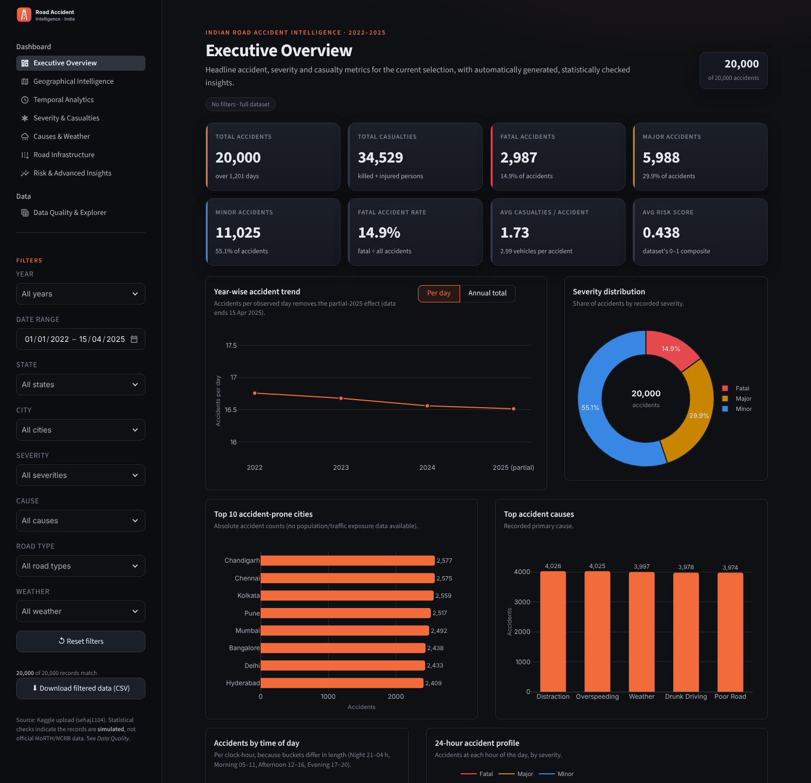

# 🛣️ Indian Road Accident Analytics & Intelligence Dashboard (2022–2025)

An end-to-end data analytics project: a profiling and cleaning pipeline, a statistically careful exploratory analysis, and an eight-page interactive **Streamlit + Plotly** dashboard built on 20,000 road-accident records from eight Indian cities.



More screenshots: [Temporal Analytics](docs/screenshots/temporal.png) · [Severity & Casualties](docs/screenshots/severity.png). Screenshots were captured offline, so the map tiles and web font are not shown.

---

## 1. Project overview

This project takes a public road-accident dataset, inspects every column for quality problems and provenance, cleans and enriches it, and analyses it across geography, time, severity, cause, weather, infrastructure, festivals and risk. The results are presented in a dark-themed "traffic intelligence" dashboard with global filters. Every KPI, chart and written insight is recomputed live for the current filter selection.

The project puts **analytical correctness** first. Every rate uses the right denominator. Partial periods are normalised. Every "highest/lowest" claim carries a hypothesis test, and every test is corrected for multiple comparisons. The dashboard says plainly when a pattern is indistinguishable from chance.

## 2. Problem statement

Road-safety decisions need to know *where*, *when* and *under what conditions* accidents happen and turn fatal. Raw accident tables are hard to explore. Naive analyses often mislead: they rank categories whose differences are pure noise, compare a partial year with full ones, or treat a derived score as independent evidence. The goal is to build a trustworthy, explorable analytics product that separates real patterns from artefacts.

## 3. Objectives

1. Profile the complete dataset: schema, types, missing values, duplicates, invalid values, coordinates, derived/leaky columns and provenance.
2. Build a reproducible preprocessing pipeline that never modifies the raw file and documents every decision.
3. Run a complete EDA (sections A–J of the brief) with suitable hypothesis tests.
4. Deliver a professional, filterable, multi-page dashboard with automatically generated, statistically qualified insights.
5. Verify every KPI independently and test the app under normal, filtered and empty selections.

## 4. Dataset

| Item | Value |
|---|---|
| File | `data/raw/indian_roads_dataset.csv` (read-only, SHA-256 checked on every run) |
| Source | Kaggle upload *Indian Road Accident Dataset 2022–2025* by user `sehaj1104` |
| Records × columns | **20,000 × 24** |
| Period | 1 Jan 2022 – **15 Apr 2025** (2025 is partial) |
| Coverage | 8 cities in 7 states: Bangalore, Chandigarh, Chennai, Delhi, Hyderabad, Kolkata, Mumbai, Pune |

**Columns.** `accident_id, city, state, latitude, longitude, date, time, hour, day_of_week, is_weekend, road_type, lanes, traffic_signal, weather, visibility, temperature, traffic_density, cause, accident_severity, vehicles_involved, casualties, is_peak_hour, festival, risk_score`

### Provenance verdict: likely simulated

The dataset is **not** official MoRTH, NCRB or iRAD data. No collecting agency or methodology is documented, and the profile (`reports/data_profile.md`) found strong signs of simulation:

- 8 of 9 categorical/temporal distributions (city, hour, weekday, cause, weather, road type, lanes, month) are statistically indistinguishable from a **uniform** split. Real crash data is strongly skewed.
- Every timestamp is exactly on the hour.
- `risk_score` is reproduced **exactly (100% of rows)** by
  `min(1, 0.10 + 0.20·fatal + 0.20·high density + 0.15·peak hour + 0.15·(fog|rain) + 0.20·low visibility + 0.10·festival)`.
- `visibility` is a function of `weather` (clear → high, fog → low, rain → low/medium).
- Casualties never exceed vehicles, and for every fatal accident casualties = vehicles.
- 1,725 "major" accidents have zero casualties.
- `accident_id` is a 0…n-1 row index.
- Festival labels sit on real festival dates, but only 2023–24 dates are labelled; 2022 and 2025 festival days are not.

**All findings therefore describe this dataset, not Indian road safety.**

## 5. Technologies

Python 3.11+ · pandas · NumPy · SciPy (χ², Kruskal–Wallis, Mann–Whitney, binomial, Wilson CIs) · Plotly (incl. MapLibre maps) · Streamlit (multi-page `st.navigation`, session state, caching) · pytest + Streamlit `AppTest` · Jupyter.

## 6. Data preprocessing methodology (`src/preprocessing.py`)

`python -m src.preprocessing` runs the pipeline. It writes the cleaned CSV, a JSON profile and cleaning log, and the Markdown reports `reports/data_profile.md` and `reports/cleaning_report.md`.

| Step | Decision |
|---|---|
| Schema | Missing expected columns are created empty; unexpected columns are kept (never silently dropped). |
| Text | Whitespace trimmed; textual null tokens (`""`, `NA`, `null`…) → missing. |
| Categories | Case/spelling unified through alias maps (e.g. `Bengaluru→Bangalore`, `Over-speeding→overspeeding`); unknown severities → missing. |
| Types & validity | Non-numeric → missing. Impossible values (hour ∉ 0–23, risk ∉ [0,1], temperature ∉ [-30,55] °C, vehicles < 1, negative casualties, non-binary flags) → **missing; the record is kept**. |
| Duplicates | Only exact duplicate rows are dropped. Same-id/different-content rows are kept and flagged (`dq_duplicate_id`). Real data: 0 duplicates. |
| Dates/time | Dates parsed. `time` normalised from mixed `H:MM`/`HH:MM` to `HH:00`. `time` is authoritative for `hour`; the date is authoritative for `day_of_week`/`is_weekend` (all agree 100% in the real data). |
| Coordinates | Validated against India's bounding box and a 75 km radius of each city's median point. Invalid points get `coord_valid = 0` and are excluded from maps, never moved or imputed (real data: all valid). |
| Missing values | `festival` missing is structural → `festival_name = "No Festival"` (raw column kept). No other imputation, because imputing accident facts would fabricate data. |
| Outliers | IQR (1.5×) and \|z\| > 3 flags (`outlier_*`); nothing deleted. |
| Quality flags | `dq_major_zero_casualties` marks the 1,725 logically inconsistent records. |

**Engineered features (30 added; 54 columns total):** `year, month, month_name, quarter, year_month, year_quarter, week_of_year, day_type (Weekday/Weekend), time_of_day (Morning 05–11, Afternoon 12–16, Evening 17–20, Night 21–04), peak_label, season (IMD), festival_flag, festival_name, severity_category, severity_rank, is_fatal, casualties_per_vehicle, has_casualties, collision_type, signal_label, risk_band, condition_risk` (the risk score without its severity term, for non-circular comparisons), `coord_valid, km_from_city_centre`, plus the data-quality and outlier flags.

**Result:** 20,000 → 20,000 records (none removed), 24 → 54 columns.

## 7. EDA methodology (`src/analysis.py`, `src/report.py`)

- **Whole dataset**, never a sample. `python -m src.report` writes the full EDA, sections A–J, to `reports/eda_findings.md`.
- **Correct denominators:** fatality rate = fatal ÷ accidents *in the same group*. Time-of-day buckets are compared **per clock-hour**, weekday/weekend **per calendar day**, seasons **per day**, and years **per observed day** plus a **same calendar window** (1 Jan–15 Apr) because 2025 is partial.
- **Uncertainty:** every rate gets a 95% Wilson interval; groups below 30 accidents are labelled unreliable.
- **Tests (assumptions checked):** χ² independence with Cramér's V (only interpreted if ≥80% of expected counts ≥ 5); Kruskal–Wallis and Mann–Whitney for the discrete, non-normal casualties and risk score; two-proportion z-tests; exact binomial tests for small groups; Spearman correlation.
- **Multiple comparisons:** Benjamini–Hochberg FDR across the test battery and across all "risk profile" combinations.
- **Terminology** is kept strict: *accidents* (records), *fatal accidents* (severity = fatal), *casualties* (killed + injured persons). **Fatalities (deaths) are not in the data and are never reported.**
- Correlation is never presented as causation; associations that come from the dataset's own construction rules are labelled as such.

## 8. Dashboard features

**Global filters** (sidebar, shared by every page through `st.session_state`): Year, Date range, State, City (options narrow to the chosen states), Severity, Cause, Road type, Weather. Also: a **Reset filters** button, a live "*n* of 20,000 records" counter, active-filter chips, and **CSV download** of the filtered data. The filtered frame is cached per filter combination, so only what changed is recomputed. An empty selection shows a friendly empty state instead of broken charts.

| Page | Contents |
|---|---|
| **1 · Executive Overview** | 8 KPI cards (accidents, casualties, fatal/major/minor, fatal %, avg casualties, avg risk); year-wise trend (per-day / annual toggle, partial year marked); severity donut; top-10 cities; top causes; accidents per clock-hour by time of day; 24-hour severity profile; **15 auto-generated insights**, each badged *Significant / Weak evidence / Not significant / Low reliability / Descriptive*. |
| **2 · Geographical Intelligence** | Interactive MapLibre map of all valid coordinates (points coloured by severity, or hotspot density; city focus; offline basemap toggle); state distribution; state fatality rate with CIs; city comparison with a metric picker; top-10 cities by fatal accidents; severity mix and casualty share by city; sortable city table with a χ² test. |
| **3 · Temporal Analytics** | Monthly trend (count / per day / fatality rate; partial month flagged); year-over-year by month; like-for-like same-window comparison; day-of-week per calendar day; hour-of-day with peak hours highlighted; day × hour heatmap (count or fatality rate); weekend vs weekday and peak vs off-peak panels with tests; time-of-day severity; IMD seasons. |
| **4 · Severity & Casualties** | Severity counts, total and average casualties; casualty-count distribution; severity by state, road type, weather, traffic density, vehicles involved and time of day; fatality-rate comparison across **any of 15 dimensions** with CIs and χ²; severity across quarters; fatality rate by year. |
| **5 · Causes & Weather** | Accidents and fatality rate by cause; cause × severity (counts or %); casualties by cause; accidents, fatal accidents and casualties by weather; visibility vs severity; weather × visibility structure; weather-wise risk score; temperature frequency and fatality rate by temperature band; traffic density vs severity and density by hour. |
| **6 · Road Infrastructure** | Road-type and lane-count distributions with fatality rates; traffic signal vs severity; density by road type; road type × lanes fatality heatmap; road × signal casualty table with χ² tests. |
| **7 · Risk & Advanced Insights** | Risk-score formula disclosure; distribution (risk or condition risk); risk by severity, city and cause; Spearman correlation heatmap; vehicles vs casualties (jittered); **highest-risk profile finder** (combine up to 5 conditions, minimum group size, rank by fatality rate / casualties / risk, with Wilson CIs and FDR-adjusted p-values); tabs for hypothesis tests, descriptive statistics, outliers and severity profiles. |
| **8 · Data Quality & Explorer** | Provenance verdict and evidence; column profile, derived-column checks, uniformity tests, consistency checks, festival-calendar audit; full cleaning log; searchable, column-selectable table of the filtered records with CSV download. |

**Design:** charcoal surfaces, an orange road-safety accent, and severity colours (fatal red / major amber / minor blue) checked for contrast and colour-vision-deficiency separation on the dark background. Categorical hues are assigned in a fixed order, magnitude scales use a single hue, and correlations use a neutral-midpoint diverging scale. The layout uses rounded cards with subtle shadows, Inter type and responsive grids. Every chart has rich hover tooltips; there are no dual axes.

## 9. Project architecture

```
road-accident-analytics/
├── app.py                         # router: page config, CSS, navigation, global filters, download
├── requirements.txt
├── README.md
├── .streamlit/config.toml         # dark theme
├── assets/  styles.css · logo.svg · logo_icon.svg
├── data/
│   ├── raw/indian_roads_dataset.csv          # original, never modified
│   └── processed/cleaned_road_accidents.csv  # + data_profile.json, cleaning_log.json
├── notebooks/
│   ├── indian_road_accidents_eda.ipynb       # complete EDA, executed, built on src/
│   └── original_kaggle_eda.ipynb             # the notebook provided (unchanged)
├── src/
│   ├── config.py          # paths, schema, aliases, valid ranges, calendars, constants
│   ├── data_loader.py     # read raw / cleaned; auto-rebuild when stale
│   ├── profiling.py       # Phase 1 dataset profile + provenance checks
│   ├── preprocessing.py   # Phase 2 cleaning + feature engineering (CLI)
│   ├── analysis.py        # Phase 3 metrics, rates, CIs, tests, profiles
│   ├── insights.py        # Phase 6 dynamic, statistically qualified insights
│   ├── visualizations.py  # Plotly theme + chart builders
│   ├── report.py          # writes reports/eda_findings.md
│   ├── ui.py              # Streamlit components, filters, session state, caching
│   └── utils.py
├── pages/  1_Overview.py … 7_Risk_Insights.py · 8_Data_Quality_Explorer.py
├── reports/  data_profile.md · cleaning_report.md · eda_findings.md · kpi_verification.md
├── scripts/verify_kpis.py         # independent KPI verification
├── tests/  test_app.py · test_pipeline.py · test_kpis.py · make_fixture.py
└── docs/screenshots/
```

Data flow: raw CSV → `profiling` + `preprocessing` → cleaned CSV → cached in `ui.get_data()` → filtered by `ui.filtered()` (cached per filter signature) → `analysis` / `insights` → `visualizations` → pages.

## 10. Installation and execution

```bash
cd road-accident-analytics
python -m venv .venv && source .venv/bin/activate      # Windows: .venv\Scripts\activate
pip install -r requirements.txt
streamlit run app.py
```

The app opens at http://localhost:8501. If `data/processed/` is empty or older than the raw file, the pipeline runs automatically on first load.

Optional commands:

```bash
python -m src.preprocessing      # rebuild cleaned data + profile + cleaning report
python -m src.report             # regenerate reports/eda_findings.md
python scripts/verify_kpis.py    # independent KPI check → reports/kpi_verification.md
pytest -q                        # 36 tests: pipeline, KPIs, every page, filters, empty state, reset
jupyter notebook notebooks/indian_road_accidents_eda.ipynb
```

The street basemap uses CARTO tiles and needs internet. Without it, switch off **Street basemap** on the map page to plot points on a plain background.

## 11. Quality checks performed

- Pipeline run end to end; raw file checksum verified unchanged.
- All 24 raw columns carried into the cleaned file; values verified identical after cleaning.
- **60/60 KPIs and aggregates** match an independent pandas computation on the raw CSV, and **15/15** match values embedded in the original notebook (`reports/kpi_verification.md`).
- Every page rendered headlessly on the full data, under 8 single-value filters, under multi-filter combinations, a single-day range and an **empty** selection; reset and state→city pruning tested.
- Pipeline robustness tested on a deliberately dirty fixture (duplicates, misspellings, impossible values, bad coordinates and dates, missing values). The fixture is used only in tests and never touches `data/`.
- Fresh-environment install and test run passed on pandas 3.1 and pandas 2.2 with zero warnings.

## 12. Key findings

Full tables are in `reports/eda_findings.md`.

**Overall.** 20,000 accidents, 34,529 casualties (1.73 per accident), 2.99 vehicles per accident. 2,987 fatal (14.9%), 5,988 major (29.9%) and 11,025 minor (55.1%).

**Trend.** Accidents per day: 16.76 (2022) → 16.68 → 16.56 → 16.51 (2025, to 15 Apr). Over the same 1 Jan–15 Apr window: 1,764 / 1,761 / 1,713 / 1,734. **Flat**: year-to-year differences are not significant (p = 0.80). The apparent 2025 "drop" in annual totals is only the partial year.

**Geography.** Cities each hold 12.0–12.9% of accidents (Chandigarh 2,577 … Hyderabad 2,409), a near-even split (p = 0.077). City fatality rates range from 14.0% (Hyderabad) to 15.8% (Pune), but the differences are not significant (χ² p = 0.45, Cramér's V = 0.018). Maharashtra leads the states only because it contains two cities.

**Time.** Per clock-hour, the four time-of-day buckets differ by under 3% (819–841 accidents per hour), and the hourly distribution is flat (p = 0.47). Weekend and weekday see 16.6 and 16.7 accidents per day. Peak and off-peak see 825 and 836 per hour, with identical fatality rates (15.0% vs 14.9%).

**Severity and its drivers.** After multiple-testing correction, **no factor** (city, state, cause, weather, visibility, road type, traffic density, lanes, signal, time, weekday/weekend, peak, season, year, vehicles) is significantly associated with whether an accident is fatal. The largest raw spread, by cause (13.5% distraction vs 15.7% poor road, p = 0.045), does not survive correction. The highest-fatality condition profiles (e.g. urban + rain + afternoon + medium density at 23%) are what chance produces when 106 groups are ranked: 0 are significant after FDR correction.

**Casualties.** Fatal accidents average 3.00 casualties, against 1.49 (major) and 1.51 (minor). Major and minor are indistinguishable, and major includes 1,725 zero-casualty records.

**Festivals.** 115 labelled records (Holi 38, Eid 34, Diwali 31, New Year 12). Holi shows 13/38 fatal (34%, binomial p = 0.002), but this rests on two dates and 38 records. New Year (0/12) and Diwali (3/31) are below the baseline. Festival risk scores are higher only because the formula adds +0.10.

**Risk score.** It is a deterministic formula that includes severity. Its higher average for fatal accidents (0.61 vs 0.41) is entirely its severity term: **condition risk is identical across severities**. It does not vary by city or cause (p = 0.92 and 0.16).

**The only real structure** is a set of generation rules: traffic density depends on the hour (high density concentrates at 08–10 h and 17–19 h; Cramér's V = 0.33), visibility depends on weather, casualties ≤ vehicles, and fatal casualties = vehicles.

### The original notebook's "Key Takeaways" against the same data

| Original claim | What the data shows |
|---|---|
| Overspeeding is the largest cause | Distraction 4,026 vs overspeeding 4,025; all five causes are an even split (p = 0.96). |
| Drunk driving has the highest fatality rate | Poor road is highest (15.7%) vs drunk driving (15.5%); not significant after correction. |
| Fog is deadlier than rain | 15.0% vs 15.0% (p = 0.96). |
| Highways have a significantly higher fatality rate | Urban is highest (15.4%), highway 14.9%; p = 0.36. |
| Late night (0–4 h) has the highest fatality rate | 21–23 h is highest (15.7%); 0–4 h is 14.9%; differences not significant. |
| Weekends show more drunk driving and fatalities | Drunk-driving share 19.7% weekend vs 20.0% weekday; fatality rate 15.1% vs 14.9% (p = 0.73). |
| Diwali and New Year are the most dangerous festivals | New Year 0/12 fatal and Diwali 9.7%, both *below* baseline. |
| Off-peak accidents are more severe | Fatality rate 14.9% vs 15.0%; casualties equal. |
| Risk score correlation with severity validates it | Circular: severity is an input to the score. |

## 13. Limitations

- **Simulated data:** the results cannot inform real road-safety policy. For official statistics, see MoRTH's annual *Road Accidents in India* and NCRB's *Accidental Deaths & Suicides in India*.
- **No exposure data** (population, vehicle-km, hours of each weather): counts show where accidents were *recorded*, not where travel is riskier.
- **No deaths count:** "fatalities" cannot be measured; only fatal-accident counts and casualties.
- **Partial 2025** (to 15 Apr) and **incomplete festival labelling** (2023–24 only).
- **Derived columns** (`risk_score`, `visibility`, `hour`, `day_of_week`, `is_weekend`, `is_peak_hour`) are not independent evidence.
- **Coordinates** are scattered around city centres without road snapping, so sub-city hotspots are not meaningful.
- **No machine-learning model** was built: severity is statistically independent of every recorded condition, so a classifier would learn nothing beyond the base rate. The only "predictable" target, risk score, is a known formula.
